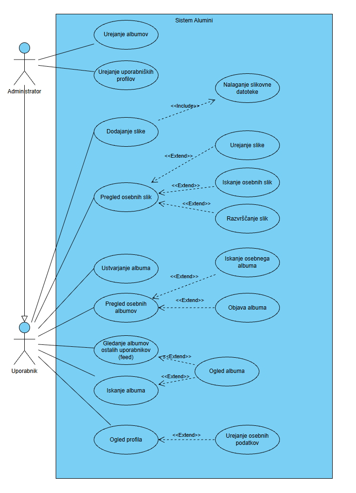

# Alumini

Spletna aplikacija za upravljanje zbirke slik (dodajanje, urejanje, brisanje, iskanje in paginacija zapisov).

## Člani skupine

| Ime in priimek |
|---|
| Žan Čahuk |
| Uroš Kuhar |
| Žiga Raus |

## Kazalo

1. [O projektu](#o-projektu)
2. [Vizija projekta](#vizija-projekta)
3. [Besednjak](#besednjak)
4. [Diagram primerov uporabe](#diagram-primerov-uporabe)
5. [Uporabljene tehnologije](#uporabljene-tehnologije)
6. [Struktura projekta](#struktura-projekta)
7. [Navodila za nameščanje in zagon](#navodila-za-nameščanje-in-zagon)
8. [Navodila za razvijalce](#navodila-za-razvijalce)
9. [Standardi kodiranja](#standardi-kodiranja)

---

## O projektu

Alumini je celovita (full-stack) aplikacija, sestavljena iz React odjemalca (frontend) in Spring Boot strežnika (backend) s PostgreSQL bazo.

**Cilji projekta:**

- upravljanje zapisov o slikah (ime, tip, velikost),
- polni CRUD (ustvarjanje, branje, urejanje, brisanje),
- iskanje po imenu ali tipu in strežniška paginacija (5 zapisov na stran),
- jasna ločitev med odjemalcem, REST API-jem in bazo.

**Funkcionalnosti (trenutna različica):**

| Funkcionalnost | Opis |
|---|---|
| Pregled slik | Tabela vseh zapisov z akcijami Uredi in Izbriši |
| Dodajanje | Obrazec na poti `/slike/dodaj` |
| Urejanje | Obrazec na poti `/slike/uredi/:id` |
| Brisanje | Potrditveno okno in osvežitev seznama |
| Iskanje | Iskanje po imenu ali tipu (brez razlikovanja velikih in malih črk) |
| Paginacija | Strani se izračunajo v bazi (`LIMIT` / `OFFSET`) |

---

## Vizija projekta

### Opis rešitve

Alumini je spletna galerija slik za alumni skupnost (npr. diplomante fakultete). Fotografije z dogodkov, generacij in skupnih trenutkov so danes razpršene po zasebnih albumih, družbenih omrežjih in e-poštnih sporočilih. Alumini jih zbere na enem mestu: vsak član skupnosti ima svoj profil, v katerem dodaja, ureja, išče in razvršča svoje slike, jih združuje v albume in albume objavi. Objavljeni albumi drugih alumnov so vidni v skupnem feedu in pri iskanju albumov.

**Kaj želimo doseči:**

- alumnom olajšati obujanje spominov in ohranjanje stikov,
- skupnosti zagotoviti urejen, preiskljiv in trajen arhiv fotografij,
- upravljavcem omogočiti nadzor nad albumi in uporabniškimi profili.

**Komu je namenjena:**

| Skupina | Kaj dobi |
|---|---|
| Uporabniki (alumni) | upravljanje osebnih slik (pregled, iskanje, razvrščanje, dodajanje z nalaganjem datoteke, urejanje), ustvarjanje, pregled, iskanje in objava osebnih albumov, feed in iskanje albumov ostalih uporabnikov, ogled profila in urejanje osebnih podatkov |
| Administratorji | vse, kar lahko uporabnik, ter urejanje albumov in uporabniških profilov vseh uporabnikov |

### Ključne funkcionalnosti

Stolpec PU se sklicuje na tabelo pod [diagramom primerov uporabe](#diagram-primerov-uporabe).

| Funkcionalnost | Opis | PU | Stanje |
|---|---|---|---|
| Pregled slik | seznam slik po straneh | PU1 | implementirano (brez uporabniških računov) |
| Iskanje slik | iskanje po imenu ali tipu | PU2 | implementirano |
| Dodajanje slike | vnos novega zapisa o sliki | PU3 | implementirano (brez datoteke) |
| Urejanje slike | sprememba podatkov o sliki | PU4 | implementirano |
| Brisanje slike | odstranitev zapisa s potrditvijo | – | implementirano (manjka v diagramu) |
| Nalaganje slikovnih datotek | shranjevanje datoteke skupaj z zapisom | PU5 | načrtovano |
| Razvrščanje slik | razvrščanje po imenu, tipu, velikosti ali času | PU6 | načrtovano |
| Osebni albumi | ustvarjanje, pregled in iskanje lastnih albumov | PU7–PU9 | načrtovano |
| Objava albuma | album postane viden ostalim uporabnikom | PU10 | načrtovano |
| Feed in iskanje albumov | pregled, iskanje in ogled objavljenih albumov ostalih uporabnikov | PU11–PU13 | načrtovano |
| Uporabniški profil | ogled profila in urejanje osebnih podatkov | PU14, PU15 | načrtovano |
| Administracija | urejanje uporabniških profilov in albumov | PU16, PU17 | načrtovano |

Podroben opis vseh načrtovanih primerov uporabe je v [primeri-uporabe.md](primeri-uporabe.md).

### Obseg rešitve in morebitne omejitve

**V obsegu:**

- upravljanje osebnih slik in njihovih metapodatkov (dodajanje z nalaganjem datoteke, urejanje, brisanje),
- pregled z iskanjem, razvrščanjem in paginacijo,
- osebni albumi in njihova objava,
- feed in iskanje objavljenih albumov ostalih uporabnikov,
- uporabniški profili,
- administracija albumov in uporabniških profilov.

**Izven obsega:**

- videoposnetki in drugi formati razen slik,
- komentarji, zasebna sporočila in drugi družabni elementi,
- mobilna aplikacija,
- plačljive storitve.

**Omejitve trenutne različice:**

- hranijo se samo metapodatki (ime, tip, velikost), ne pa slikovne datoteke,
- aplikacija nima uporabniških računov in prijave, zato so vse slike skupne in lahko vsak spreminja in briše zapise,
- albumi, profili in administracija še niso implementirani,
- iskanje deluje samo po imenu in tipu,
- aplikacija teče lokalno (baza v Dockerju), brez produkcijske namestitve,
- uporabniški vmesnik je samo v slovenščini.

---

## Besednjak

| Pojem | Razlaga |
|---|---|
| Alumn | nekdanji študent oziroma diplomant, član skupnosti, ki mu je aplikacija namenjena |
| Alumni skupnost | skupina vseh alumnov, ki jim je aplikacija namenjena |
| Uporabnik | alumn z uporabniškim profilom, ki v aplikaciji upravlja svoje slike in albume ter pregleduje objavljene albume drugih |
| Administrator | uporabnik z dodatno pravico urejanja albumov in uporabniških profilov vseh uporabnikov |
| Slika | osrednji zapis v sistemu: slikovna datoteka skupaj z metapodatki |
| Osebne slike | slike, ki jih je dodal prijavljeni uporabnik |
| Metapodatki slike | podatki o sliki: ime, tip in velikost (načrtovano tudi opis in čas dodajanja) |
| Tip slike | format slikovne datoteke (npr. jpg, png, gif) |
| Velikost slike | velikost datoteke (npr. 2MB) |
| Album | poimenovana zbirka slik (npr. dogodek ali generacija) |
| Osebni album | album, ki ga je ustvaril prijavljeni uporabnik; dokler ni objavljen, je viden samo njemu |
| Objava albuma | dejanje, s katerim lastnik album naredi viden ostalim uporabnikom |
| Feed | seznam objavljenih albumov ostalih uporabnikov |
| Profil | stran uporabnika z njegovimi osebnimi podatki |
| Osebni podatki | podatki o uporabniku v profilu (npr. ime, e-pošta, opis) |

---

## Diagram primerov uporabe

Diagram prikazuje načrtovano različico aplikacije (17 primerov uporabe, 2 akterja). Administrator je specializacija uporabnika (generalizacija akterjev), zato lahko izvaja tudi vse primere uporabe uporabnika.



| ID | Primer uporabe | Akter | Povezava | Stanje |
|---|---|---|---|---|
| PU1 | Pregled osebnih slik | Uporabnik | – | implementirano (brez uporabniških računov) |
| PU2 | Iskanje osebnih slik | Uporabnik | razširja PU1 | implementirano |
| PU3 | Dodajanje slike | Uporabnik | vključuje PU5 | implementirano (brez datoteke) |
| PU4 | Urejanje slike | Uporabnik | razširja PU1 | implementirano |
| PU5 | Nalaganje slikovne datoteke | Uporabnik | vključen v PU3 | načrtovano |
| PU6 | Razvrščanje slik | Uporabnik | razširja PU1 | načrtovano |
| PU7 | Ustvarjanje albuma | Uporabnik | – | načrtovano |
| PU8 | Pregled osebnih albumov | Uporabnik | – | načrtovano |
| PU9 | Iskanje osebnega albuma | Uporabnik | razširja PU8 | načrtovano |
| PU10 | Objava albuma | Uporabnik | razširja PU8 | načrtovano |
| PU11 | Gledanje albumov ostalih uporabnikov (feed) | Uporabnik | – | načrtovano |
| PU12 | Iskanje albuma | Uporabnik | – | načrtovano |
| PU13 | Ogled albuma | Uporabnik | razširja PU11 in PU12 | načrtovano |
| PU14 | Ogled profila | Uporabnik | – | načrtovano |
| PU15 | Urejanje osebnih podatkov | Uporabnik | razširja PU14 | načrtovano |
| PU16 | Urejanje uporabniških profilov | Administrator | – | načrtovano |
| PU17 | Urejanje albumov | Administrator | – | načrtovano |

Podrobni opisi vseh še neimplementiranih primerov uporabe (PU5 do PU17) so v [primeri-uporabe.md](primeri-uporabe.md).

---

## Uporabljene tehnologije

### Backend

| Tehnologija | Različica |
|---|---|
| Java (JDK) | 25 |
| Spring Boot | 4.1.1 |
| Spring Web MVC | prek Spring Boot 4.1.1 |
| Spring Data JPA (Hibernate 7.4.5) | prek Spring Boot 4.1.1 |
| Spring Validation | prek Spring Boot 4.1.1 |
| springdoc-openapi (Swagger UI) | 3.1.0 |
| Lombok | 1.18.46 |
| PostgreSQL JDBC gonilnik | 42.7.13 |
| Maven (Maven Wrapper) | 3.x (prenese ga `mvnw`) |

### Frontend

Različice so povzete iz `package.json`.

| Tehnologija | Različica |
|---|---|
| Node.js | 22.18.0 |
| npm | 10.9.3 |
| React / React DOM | ^19.3.1 |
| react-router | ^7.18.4 |
| Material UI (`@mui/material`) | ^9.5.0 |
| Material UI ikone (`@mui/icons-material`) | ^9.5.0 |
| Emotion (`@emotion/react`, `@emotion/styled`) | ^11.14.0, ^11.14.1 |
| axios | ^1.20.0 |
| Create React App (`react-scripts`) | 5.0.1 |
| cross-env (razvojna odvisnost) | ^10.1.0 |
| Testna orodja (`@testing-library/*`) | react ^16.3.3, jest-dom ^6.9.1, dom ^10.4.2, user-event ^13.5.0 |

### Infrastruktura in orodja

| Orodje | Namen |
|---|---|
| PostgreSQL 17 | podatkovna baza (v Docker vsebniku) |
| Docker / Docker Compose | zagon baze |
| DataGrip (neobvezno) | pregled baze |
| Postman (neobvezno) | testiranje API-ja |
| Git / GitHub | verzioniranje |

---

## Struktura projekta

> Imena map prilagodite dejanskemu stanju v repozitoriju.

```
Alumini/
├── Backend/                          # Spring Boot aplikacija
│   ├── pom.xml                       # Maven odvisnosti in nastavitve prevajanja
│   ├── mvnw, mvnw.cmd                # Maven Wrapper
│   └── src/
│       └── main/
│           ├── java/com/example/alumini/
│           │   ├── AluminiApplication.java   # vstopna točka
│           │   ├── rest/                     # REST kontrolerji (SlikeController, HelloController)
│           │   ├── dao/                      # repozitoriji (SlikeDao)
│           │   └── vao/                      # entitete (Slike)
│           └── resources/
│               ├── application.properties                    # splošne nastavitve (brez gesla)
│               └── application-local.properties.example      # primer lokalnih podatkov za bazo
├── Frontend/
│   └── alumini/                      # React aplikacija
│       ├── package.json              # odvisnosti in skripte
│       ├── .env.example              # primer okoljskih spremenljivk
│       ├── public/
│       └── src/
│           ├── App.js                # BrowserRouter + usmerjanje
│           ├── services/
│           │   └── api.js            # axios instanca (baseURL)
│           └── components/
│               ├── Routing/          # definicija poti
│               ├── Slike/            # Slike, SlikeTable, DodajSliko, UrediSliko
│               └── PageNotFound/     # stran 404
├── Slike/
│   └── Use_case_diagram.png          # diagram primerov uporabe
├── docker-compose.yml                # PostgreSQL vsebnik (geslo iz .env)
├── .env.example                      # primer .env za Docker (DB_PASSWORD)
├── .gitignore
├── primeri-uporabe.md                # podrobni opisi primerov uporabe
└── README.md
```

### Razlaga map

| Mapa | Vsebina |
|---|---|
| `Backend/.../rest` | REST kontrolerji, ki sprejemajo HTTP zahteve |
| `Backend/.../dao` | Spring Data repozitoriji za dostop do baze |
| `Backend/.../vao` | JPA entitete (preslikava tabel) |
| `Backend/.../resources` | konfiguracija aplikacije |
| `Frontend/.../services` | komunikacija z backendom |
| `Frontend/.../components/Slike` | zasloni in tabela za upravljanje slik |
| `Frontend/.../components/Routing` | poti aplikacije |
| `Slike/` | slike za dokumentacijo (diagrami) |

### REST API

Osnovni naslov: `http://localhost:8080`

| Metoda | Pot | Opis |
|---|---|---|
| GET | `/slike` | vsi zapisi |
| GET | `/slike/iskanje?q=&page=&size=` | iskanje + paginacija |
| GET | `/slike/{id}` | en zapis |
| POST | `/slike` | nov zapis |
| POST | `/slike/bulk` | več zapisov naenkrat |
| PUT | `/slike/{id}` | urejanje zapisa |
| DELETE | `/slike/{id}` | brisanje zapisa |
| DELETE | `/slike` | brisanje vseh zapisov |

Swagger UI: `http://localhost:8080/swagger-ui.html`

---

## Navodila za nameščanje in zagon

### Predpogoji

| Orodje | Zahteva | Preverjanje |
|---|---|---|
| JDK | **25** (ne 26 ali 27; Lombok ju še ne podpira) | `java -version` |
| Node.js + npm | Node.js **22.18.0**, npm **10.9.3** | `node -v`, `npm -v` |
| Docker Desktop | zagnan (Engine running) | `docker version` |
| Git | katera koli novejša | `git --version` |

Maven ni treba nameščati, ker projekt vsebuje Maven Wrapper (`mvnw`).

### 1. Kloniranje

```bash
git clone https://github.com/ZanCahuk/Alumini.git
cd Alumini
```

### 2. Zagon baze (PostgreSQL v Dockerju)

Geslo za bazo ni v repozitoriju. Najprej ustvarite datoteko `.env` v korenski mapi (kjer je `docker-compose.yml`) tako, da kopirate primer:

```bash
# Windows (PowerShell)
Copy-Item .env.example .env
# Linux / macOS
cp .env.example .env
```

V `.env` zamenjajte `CHANGE_ME` z lastnim geslom:

```
DB_PASSWORD=vase_geslo
```

Nato zaženite bazo:

```bash
docker compose up -d
docker ps
```

Vsebnik `alumini-db` mora imeti status `Up`. Baza `alumini` se ustvari samodejno, tabele pa ustvari Hibernate ob prvem zagonu backenda.

Ustavitev baze: `docker compose stop`. Podatki ostanejo v Docker volumnu. Ukaza `docker compose down -v` ne uporabljajte, če želite podatke obdržati.

### 3. Zagon backenda

V mapi s `pom.xml`:

```powershell
# Windows (PowerShell)
.\mvnw.cmd spring-boot:run
```

```bash
# Linux / macOS
./mvnw spring-boot:run
```

Backend teče na `http://localhost:8080`. V dnevniku poiščite `Started AluminiApplication`.

**Podatki za bazo.** Pred prvim zagonom ustvarite `application-local.properties` (v isti mapi kot `application.properties`) tako, da kopirate primer:

```bash
# Windows (PowerShell)
Copy-Item src\main\resources\application-local.properties.example src\main\resources\application-local.properties
# Linux / macOS
cp src/main/resources/application-local.properties.example src/main/resources/application-local.properties
```

V datoteki vpišite isto geslo kot v `.env`:

```properties
spring.datasource.username=alumini
spring.datasource.password=vase_geslo
```

Datoteka `application-local.properties` je v `.gitignore` in se nikoli ne objavi.

**Splošne nastavitve (`src/main/resources/application.properties`):**

```properties
server.port=8080
spring.application.name=Alumini

spring.datasource.url=jdbc:postgresql://localhost:5432/alumini
spring.jpa.hibernate.ddl-auto=update
spring.jpa.show-sql=true

# uporabnik in geslo baze se prebereta iz te datoteke (ni v Gitu)
spring.config.import=optional:classpath:application-local.properties
```

Uporabnik (`alumini`), geslo in ime baze se morajo ujemati z `docker-compose.yml` in `.env`.

### 4. Zagon frontenda

V mapi s `package.json`:

```bash
npm install
```

Ustvarite datoteko `.env` (je v `.gitignore`, zato je ni v repozitoriju). Primer je v `.env.example`:

```
REACT_APP_BASE_URL=http://localhost:8080
```

Nato:

```bash
npm start
```

Aplikacija se odpre na `http://localhost:3000`. Po vsaki spremembi `.env` je treba `npm start` ponovno zagnati.

Skripta `npm start` privzeto odpre **Firefox** (`cross-env BROWSER=firefox`). Če Firefoxa nimate, v `package.json` zamenjajte `firefox` z drugim brskalnikom ali z `none` (brskalnik se ne odpre samodejno).

### Okoljske spremenljivke

| Spremenljivka | Kje | Pomen | Primer |
|---|---|---|---|
| `REACT_APP_BASE_URL` | Frontend `.env` | naslov backenda | `http://localhost:8080` |
| `DB_PASSWORD` | `.env` v korenski mapi | geslo baze v Dockerju | `vase_geslo` |
| `spring.datasource.username` / `password` | `application-local.properties` | prijava backenda v bazo | glej zgoraj |
| `spring.datasource.url` | `application.properties` | naslov baze | `jdbc:postgresql://localhost:5432/alumini` |
| `JAVA_HOME` | sistem | pot do JDK 25 | `C:\Program Files\Eclipse Adoptium\jdk-25...` |

### Pogoste težave

| Težava | Rešitev |
|---|---|
| `ExceptionInInitializerError` / `Could not initialize class lombok.javac.Javac` | uporabljate napačen JDK; nastavite JDK 25 |
| `cannot find symbol ... setId` pri `mvnw` | preverite `annotationProcessorPaths` za Lombok v `pom.xml` |
| `Port 8080 was already in use` | ustavite drug proces ali spremenite `server.port` |
| `password authentication failed` | geslo v `application-local.properties` ni enako `DB_PASSWORD` v `.env`; če ste geslo spremenili po prvem zagonu, ponovno ustvarite bazo z `docker compose down -v` in `docker compose up -d` |
| Docker javi `The "DB_PASSWORD" variable is not set` | manjka `.env` v korenski mapi (kopirajte `.env.example`) |
| `Unable to determine Dialect` | baza ne teče ali povezava ni pravilna |
| 404 v Reactu na `/slike` | manjka `.env` z `REACT_APP_BASE_URL` |
| `Module not found: axios` | zaženite `npm install` |

---

## Navodila za razvijalce

### Potek dela z Gitom

1. Najprej posodobite glavno vejo:
   ```bash
   git checkout main
   git pull origin main
   ```
2. Ustvarite novo vejo za vsako funkcionalnost ali popravek:
   ```bash
   git checkout -b feature/ime-funkcionalnosti
   ```
3. Delajte v majhnih korakih in pogosto potrjujte (commit):
   ```bash
   git add .
   git commit -m "feat: kratek opis spremembe"
   ```
4. Objavite vejo:
   ```bash
   git push -u origin feature/ime-funkcionalnosti
   ```
5. Na GitHubu odprite **Pull Request** proti veji `main`, opišite spremembo in počakajte na pregled.
6. Po odobritvi združite (merge) Pull Request in izbrišite vejo.

### Poimenovanje vej

| Predpona | Uporaba | Primer |
|---|---|---|
| `feature/` | nova funkcionalnost | `feature/iskanje` |
| `fix/` | popravek napake | `fix/brisanje-zadnje-strani` |
| `docs/` | dokumentacija | `docs/readme` |
| `refactor/` | preoblikovanje kode | `refactor/slike-controller` |

### Sporočila commitov

Oblika: `tip: kratek opis v ukazni obliki`

| Tip | Pomen |
|---|---|
| `feat` | nova funkcionalnost |
| `fix` | popravek napake |
| `docs` | dokumentacija |
| `refactor` | preoblikovanje brez spremembe delovanja |
| `chore` | vzdrževalna opravila (odvisnosti, konfiguracija) |

### Pravila

- Neposredno v `main` ne potrjujemo sprememb, uporabimo Pull Request.
- V repozitorij ne dodajamo `node_modules/`, `target/`, `.env`, `application-local.properties` ali drugih skrivnosti. Za vsako skrivnost dodamo `.example` datoteko s ponarejeno vrednostjo.
- Pred objavo preverite, ali se backend in frontend zaženeta.

---

## Standardi kodiranja

### Java (backend)

- Razredi: `PascalCase` (`SlikeController`), metode in spremenljivke: `camelCase`, konstante: `UPPER_SNAKE_CASE`.
- Paketi so v malih črkah: `rest`, `dao`, `vao`.
- Kontrolerji vsebujejo samo obravnavo HTTP zahtev, dostop do baze gre prek repozitorijev (`dao`).
- Za entitete uporabljamo Lombok (`@Data`); za JPA entitete poskrbimo za konstruktor brez argumentov.
- Za manjkajoče zapise vračamo ustrezne HTTP kode (`404`) prek `ResponseStatusException`.
- Pot, parametri in `@PathVariable` morajo imeti enaka imena (npr. `/slike/{id}` in `@PathVariable("id")`).
- Zamik: 4 presledki.

### JavaScript / React (frontend)

- Komponente: `PascalCase`, datoteka ima isto ime kot komponenta (`SlikeTable.js`).
- Spremenljivke in funkcije: `camelCase`.
- Samo funkcijske komponente in React Hooks (`useState`, `useEffect`).
- Vsi klici na backend gredo prek skupne `api` instance v `services/api.js`, nikoli prek golega `axios` z vpisanim naslovom.
- Naslov backenda je v okoljski spremenljivki, ne v kodi.
- Vse uvoze za usmerjanje uvažamo iz enega paketa (`react-router`).
- Zamik: 2 ali 4 presledki (v celotnem projektu enako), podpičja dosledno.

### Splošno

- Kratke, jasne funkcije z eno nalogo.
- Imena naj opisujejo namen (`izbrisiSliko`, ne `fn1`).
- Komentarji pojasnjujejo *zakaj*, ne *kaj*.
- Nobenih gesel ali ključev v kodi ali v datotekah, ki jih objavimo; skrivnosti so v `.env` in `application-local.properties`.