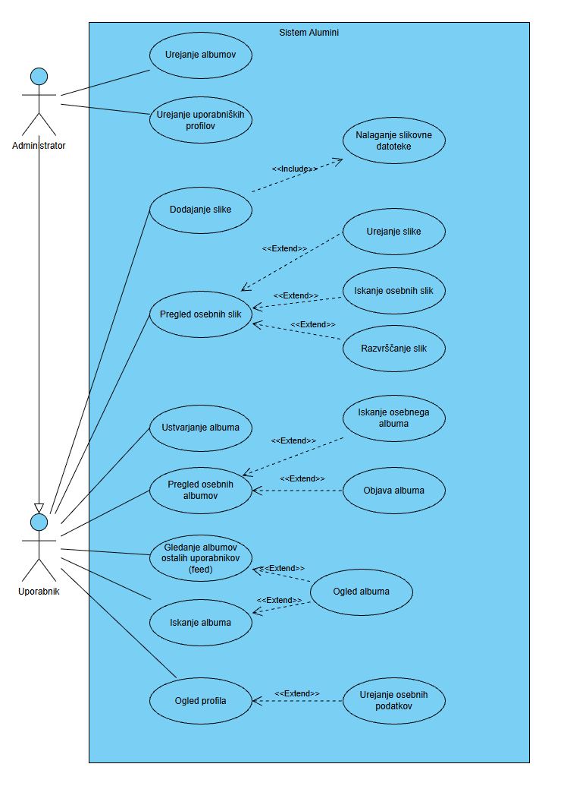
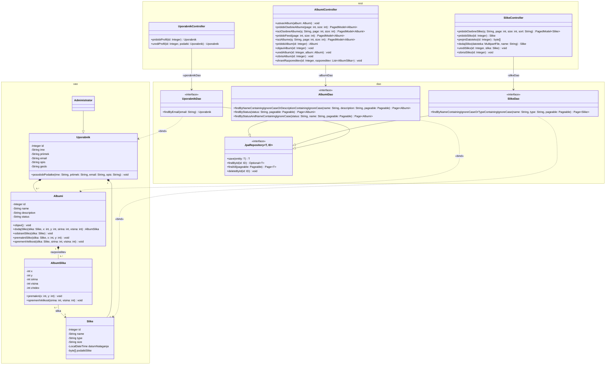
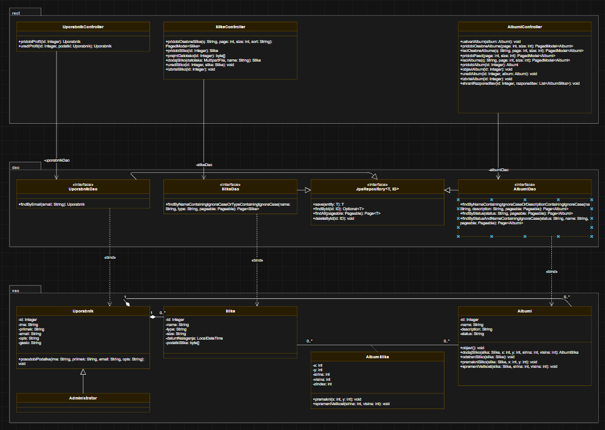

# Alumini

Spletna aplikacija za upravljanje zbirke slik in albumov (nalaganje slik, urejanje, brisanje, iskanje, paginacija, albumi s poljubno postavitvijo slik).

## Člani skupine

| Ime in priimek |
|---|
| Žan Čahuk |
| Uroš Kuhar |
| Žiga Raus |

## Kazalo

1. [O projektu](#o-projektu)
2. [Vizija projekta](#vizija-projekta)
3. [Besednjak](#besednjak)
4. [Diagram primerov uporabe](#diagram-primerov-uporabe)
5. [Razredni diagram](#razredni-diagram)
6. [Uporabljene tehnologije](#uporabljene-tehnologije)
7. [Struktura projekta](#struktura-projekta)
8. [Navodila za nameščanje in zagon](#navodila-za-nameščanje-in-zagon)
9. [Navodila za razvijalce](#navodila-za-razvijalce)
10. [Standardi kodiranja](#standardi-kodiranja)
 
##### Dokumentacija

- [Uporabniške zgodbe](docs/user-stories.md)

---

## O projektu

Alumini je celovita (full-stack) aplikacija, sestavljena iz React odjemalca (frontend) in Spring Boot strežnika (backend) s PostgreSQL bazo.

**Cilji projekta:**

- upravljanje slik (nalaganje datotek, ime, tip, velikost, čas nalaganja),
- upravljanje albumov in njihova objava,
- prosta postavitev slik v albumu (premikanje in spreminjanje velikosti na platnu),
- polni CRUD (ustvarjanje, branje, urejanje, brisanje) za slike in albume,
- iskanje po imenu, tipu ali opisu in strežniška paginacija (6 zapisov na stran v vmesniku),
- jasna ločitev med odjemalcem, REST API-jem in bazo.

**Funkcionalnosti (trenutna različica):**

| Funkcionalnost | Opis |
|---|---|
| Pregled slik | Mreža kartic s predogledom slike, tipom in velikostjo; meni z akcijami Odpri, Uredi in Izbriši |
| Nalaganje slik | Povleci in spusti ali izbira datoteke na poti `/slike/dodaj` (jpg, png, do 10 MB) |
| Urejanje slike | Sprememba imena na poti `/slike/uredi/:id` (tip in velikost sta samo za branje) |
| Brisanje slike | Potrditveno okno in osvežitev seznama |
| Iskanje slik | Iskanje po imenu ali tipu (brez razlikovanja velikih in malih črk) |
| Pregled albumov | Mreža kartic z iskanjem, filtri (Vsi, Objavljeni, Zasebni) in paginacijo |
| Upravljanje albumov | Ustvarjanje, urejanje imena in opisa, brisanje |
| Objava albuma | Preklop med stanjema Zaseben in Objavljen (`PRIVATE` / `PUBLIC`) |
| Urejevalnik postavitve | Pot `/albumi/uredi/:id`: dvojni klik doda sliko na platno, nato premik, spreminjanje velikosti, odstranitev in shranjevanje postavitve |
| Ogled albuma | Postavitev slik na platnu, skalirana na širino zaslona (samo za branje) |
| Paginacija | Strani se izračunajo v bazi (`LIMIT` / `OFFSET`) |

---

## Vizija projekta

### Opis rešitve

Alumini je spletna galerija slik za alumni skupnost (npr. diplomante fakultete). Fotografije z dogodkov, generacij in skupnih trenutkov so danes razpršene po zasebnih albumih, družbenih omrežjih in e-poštnih sporočilih. Alumini jih zbere na enem mestu: vsak član skupnosti ima svoj profil, v katerem dodaja, ureja, išče in razvršča svoje slike, jih združuje v albume in albume objavi. Objavljeni albumi drugih alumnov so vidni v skupnem feedu in pri iskanju albumov.

**Kaj želimo doseči:**

- alumnom olajšati obujanje spominov in ohranjanje stikov,
- skupnosti zagotoviti urejen, preiskljiv in trajen arhiv fotografij,
- upravljavcem omogočiti nadzor nad albumi in uporabniškimi profili.

**Komu je namenjena:**

| Skupina | Kaj dobi |
|---|---|
| Uporabniki (alumni) | upravljanje osebnih slik (pregled, iskanje, razvrščanje, dodajanje z nalaganjem datoteke, urejanje), ustvarjanje, pregled, iskanje in objava osebnih albumov z lastno postavitvijo slik, feed in iskanje albumov ostalih uporabnikov, ogled profila in urejanje osebnih podatkov |
| Administratorji | vse, kar lahko uporabnik, ter urejanje albumov in uporabniških profilov vseh uporabnikov |

### Ključne funkcionalnosti

Stolpec PU se sklicuje na tabelo pod [diagramom primerov uporabe](#diagram-primerov-uporabe).

| Funkcionalnost | Opis | PU | Stanje |
|---|---|---|---|
| Pregled slik | seznam slik po straneh | PU1 | implementirano (brez uporabniških računov) |
| Iskanje slik | iskanje po imenu ali tipu | PU2 | implementirano |
| Dodajanje slike | nalaganje slikovne datoteke skupaj z zapisom | PU3 | implementirano (brez uporabniških računov) |
| Nalaganje slikovnih datotek | shranjevanje datoteke (jpg, png) v bazo | PU5 | implementirano |
| Urejanje slike | sprememba imena slike | PU4 | implementirano (spremeni se samo ime) |
| Brisanje slike | odstranitev zapisa s potrditvijo | – | implementirano (manjka v diagramu) |
| Razvrščanje slik | razvrščanje po imenu, tipu, velikosti ali času | PU6 | načrtovano |
| Ustvarjanje albuma | nov album z imenom in opisom | PU7 | implementirano (brez uporabniških računov) |
| Pregled osebnih albumov | seznam albumov po straneh | PU8 | implementirano (brez uporabniških računov) |
| Iskanje osebnega albuma | iskanje po imenu ali opisu | PU9 | implementirano |
| Objava albuma | preklop stanja Zaseben / Objavljen | PU10 | delno (stanje se shrani, vpliva na vidnost šele s feedom in računi) |
| Postavitev slik v albumu | premik, sprememba velikosti in shranjevanje postavitve na platnu | – | implementirano (manjka v diagramu; rotacija načrtovana) |
| Brisanje in urejanje albuma | sprememba podatkov in odstranitev albuma | – | implementirano (manjka v diagramu) |
| Feed in iskanje albumov | pregled, iskanje in ogled objavljenih albumov ostalih uporabnikov | PU11–PU13 | načrtovano |
| Uporabniški profil | ogled profila in urejanje osebnih podatkov | PU14, PU15 | načrtovano |
| Administracija | urejanje uporabniških profilov in albumov | PU16, PU17 | načrtovano |

Podroben opis vseh načrtovanih primerov uporabe je v [primeri-uporabe.md](primeri-uporabe.md).

### Obseg rešitve in morebitne omejitve

**V obsegu:**

- upravljanje osebnih slik in njihovih metapodatkov (dodajanje z nalaganjem datoteke, urejanje, brisanje),
- pregled z iskanjem, razvrščanjem in paginacijo,
- osebni albumi, postavitev slik v albumu in objava albumov,
- feed in iskanje objavljenih albumov ostalih uporabnikov,
- uporabniški profili,
- administracija albumov in uporabniških profilov.

**Izven obsega:**

- videoposnetki in drugi formati razen slik,
- komentarji, zasebna sporočila in drugi družabni elementi,
- mobilna aplikacija,
- plačljive storitve.

**Omejitve trenutne različice:**

- podprti formati slik so samo jpg in png; vmesnik dovoli datoteke do 10 MB, backend pa jih sprejme do 30 MB (`spring.servlet.multipart.max-file-size`),
- slikovne datoteke se hranijo neposredno v bazi (stolpec s podatki slike), ne v datotečnem sistemu,
- aplikacija nima uporabniških računov in prijave, zato so vse slike in albumi skupni in lahko vsak spreminja in briše zapise,
- objava albuma samo spremeni stanje; feed in iskanje albumov drugih uporabnikov še nista implementirana,
- profili in administracija še niso implementirani,
- slik ni mogoče razvrščati (iskanje deluje samo po imenu in tipu),
- v urejevalniku albuma ni vrtenja slik (podatek o rotaciji se hrani, uporabniški vmesnik zanj še ne obstaja),
- filtri Objavljeni / Zasebni pri albumih in filter tipa pri slikah delujejo samo na trenutni strani rezultatov,
- aplikacija teče lokalno (baza v Dockerju), brez produkcijske namestitve,
- uporabniški vmesnik je samo v slovenščini.

---

## Besednjak

| Pojem | Razlaga |
|---|---|
| Alumn | nekdanji študent oziroma diplomant, član skupnosti, ki mu je aplikacija namenjena |
| Alumni skupnost | skupina vseh alumnov, ki jim je aplikacija namenjena |
| Uporabnik | alumn z uporabniškim profilom, ki v aplikaciji upravlja svoje slike in albume ter pregleduje objavljene albume drugih |
| Administrator | uporabnik z dodatno pravico urejanja albumov in uporabniških profilov vseh uporabnikov |
| Slika | osrednji zapis v sistemu: slikovna datoteka skupaj z metapodatki |
| Osebne slike | slike, ki jih je dodal prijavljeni uporabnik |
| Metapodatki slike | podatki o sliki: ime, tip, velikost in čas nalaganja (načrtovano tudi opis) |
| Tip slike | format slikovne datoteke (jpg ali png) |
| Velikost slike | velikost datoteke v MB (npr. 2.00 MB) |
| Album | poimenovana zbirka slik (npr. dogodek ali generacija) z imenom, opisom in stanjem |
| Osebni album | album, ki ga je ustvaril prijavljeni uporabnik; dokler ni objavljen, je viden samo njemu |
| Objava albuma | dejanje, s katerim lastnik album naredi viden ostalim uporabnikom (stanje `PUBLIC`) |
| Zaseben album | album v stanju `PRIVATE` |
| Platno | površina logične velikosti 1200 × 800 enot, na katero se v albumu postavijo slike; na zaslonu se samo skalira |
| Postavitev | položaj slike na platnu: x, y, širina, višina, rotacija in z-indeks |
| Feed | seznam objavljenih albumov ostalih uporabnikov |
| Profil | stran uporabnika z njegovimi osebnimi podatki |
| Osebni podatki | podatki o uporabniku v profilu (npr. ime, e-pošta, opis) |

---

## Diagram primerov uporabe

Diagram prikazuje načrtovano različico aplikacije (17 primerov uporabe, 2 akterja). Razredni diagram je v poglavju [Razredni diagram](#razredni-diagram). Administrator je specializacija uporabnika (generalizacija akterjev), zato lahko izvaja tudi vse primere uporabe uporabnika.



| ID | Primer uporabe | Akter | Povezava | Stanje |
|---|---|---|---|---|
| PU1 | Pregled osebnih slik | Uporabnik | – | implementirano (brez uporabniških računov) |
| PU2 | Iskanje osebnih slik | Uporabnik | razširja PU1 | implementirano |
| PU3 | Dodajanje slike | Uporabnik | vključuje PU5 | implementirano (brez uporabniških računov) |
| PU4 | Urejanje slike | Uporabnik | razširja PU1 | implementirano (samo ime) |
| PU5 | Nalaganje slikovne datoteke | Uporabnik | vključen v PU3 | implementirano |
| PU6 | Razvrščanje slik | Uporabnik | razširja PU1 | načrtovano |
| PU7 | Ustvarjanje albuma | Uporabnik | – | implementirano (brez uporabniških računov) |
| PU8 | Pregled osebnih albumov | Uporabnik | – | implementirano (brez uporabniških računov) |
| PU9 | Iskanje osebnega albuma | Uporabnik | razširja PU8 | implementirano |
| PU10 | Objava albuma | Uporabnik | razširja PU8 | delno (samo preklop stanja) |
| PU11 | Gledanje albumov ostalih uporabnikov (feed) | Uporabnik | – | načrtovano |
| PU12 | Iskanje albuma | Uporabnik | – | načrtovano |
| PU13 | Ogled albuma | Uporabnik | razširja PU11 in PU12 | delno (ogled lastnega albuma s postavitvijo) |
| PU14 | Ogled profila | Uporabnik | – | načrtovano |
| PU15 | Urejanje osebnih podatkov | Uporabnik | razširja PU14 | načrtovano |
| PU16 | Urejanje uporabniških profilov | Administrator | – | načrtovano |
| PU17 | Urejanje albumov | Administrator | – | načrtovano |

V diagramu manjkajo še implementirani funkcionalnosti: brisanje slike, urejanje in brisanje albuma ter urejevalnik postavitve slik v albumu.

Podrobni opisi še neimplementiranih primerov uporabe (PU6, PU11 do PU17) so v [primeri-uporabe.md](primeri-uporabe.md).

---

## Razredni diagram

Razredni diagram vključuje vse funkcionalnosti iz diagrama primerov uporabe (PU1–PU17), tudi tiste, ki še niso implementirane (uporabnik, administrator, feed). Razporeditev slik v albumu je v kodi že implementirana kot entiteta `AlbumSlike` (v diagramu `AlbumSlika`, z atributi `width` / `height` namesto `sirina` / `visina` in z dodatnim `rotation`). Urejljiva različica je v [`docs/razredni-diagram/Alumini.drawio`](docs/razredni-diagram/Alumini.drawio), spodnji diagram pa je zapisan v Mermaidu (GitHub ga izriše sam).





### Uporabljene povezave

| Povezava | Zapis | Pomen v diagramu |
|---|---|---|
| Dedovanje (generalizacija) | polna črta, prazen trikotnik | `Administrator` → `Uporabnik`; `SlikeDao`, `AlbumiDao`, `UporabnikDao` → `JpaRepository` |
| Asociacija (usmerjena) | polna črta, odprta puščica | kontroler uporablja svoj DAO |
| Odvisnost | črtkana črta, odprta puščica | DAO je vezan na entiteto (`«bind»`, generična parametra `<Entiteta, Integer>`) |
| Kompozicija | polni romb pri celoti | `Uporabnik` vsebuje svoje `Slike` in `Albumi` (1 : 0..\*) |
| Asociacijski razred | `AlbumSlika` med `Albumi` in `Slike` | postavitev slike v albumu (x, y, širina, višina, zIndex) |

V `.drawio` datoteki je `AlbumSlika` pravi asociacijski razred (črtkana črta do asociacije `Albumi` 0..\* — 0..\* `Slike`). Mermaid tega ne podpira, zato je tam prikazan kot razred s kompozicijo do `Albumi` in asociacijo do `Slike`.

### Opis razredov

#### Paket `rest` (kontrolerji)

| Razred | Naloga | Ključne metode |
|---|---|---|
| `SlikeController` | REST vmesnik za slike (`/slike`) | `pridobiOsebneSlike` – iskanje, paginacija in razvrščanje (PU1, PU2, PU6); `dodajSliko` – naloži datoteko in jo shrani (PU3, PU5); `urediSliko` (PU4); `izbrisiSliko`; `prejmiDatoteko` – vrne vsebino slike za prikaz |
| `AlbumiController` | REST vmesnik za albume (`/albumi`) | `ustvariAlbum` (PU7); `pridobiOsebneAlbume` in `isciOsebneAlbume` (PU8, PU9); `objaviAlbum` (PU10); `pridobiFeed` (PU11); `isciAlbume` (PU12); `pridobiAlbum` (PU13); `urediAlbum` (PU17, ob istem klicu tudi administrator); `izbrisiAlbum`; `shraniRazporeditev` – shrani položaj in velikost slik v albumu |
| `UporabnikController` | REST vmesnik za profile | `pridobiProfil` (PU14); `urediProfil` – lastni podatki (PU15), administrator ga uporabi za urejanje tujih profilov (PU16) |

#### Paket `dao` (dostop do podatkov)

| Razred | Naloga | Ključne metode |
|---|---|---|
| `JpaRepository<T, ID>` | Spring Data vmesnik z osnovnimi operacijami | `save`, `findById`, `findAll`, `deleteById` |
| `SlikeDao` | Dostop do tabele slik | `findByNameContainingIgnoreCaseOrTypeContainingIgnoreCase` – iskanje po imenu ali tipu s paginacijo |
| `AlbumiDao` | Dostop do tabele albumov | iskanje po imenu ali opisu; `findByStatus` – albumi za feed; `findByStatusAndNameContainingIgnoreCase` – iskanje med objavljenimi |
| `UporabnikDao` | Dostop do tabele uporabnikov | `findByEmail` – iskanje uporabnika po e-pošti |

#### Paket `vao` (entitete)

| Razred | Naloga | Ključne metode |
|---|---|---|
| `Uporabnik` | Registriran uporabnik, lastnik slik in albumov | `posodobiPodatke` – spremeni ime, priimek, e-pošto in opis |
| `Administrator` | Podrazred uporabnika s pravico urejanja albumov in profilov drugih | brez lastnih metod |
| `Slike` | Naložena slika; podatki so v bazi (`podatkiSlike`, `bytea`) | samo atributi (getterji in setterji prek Lomboka) |
| `Albumi` | Zbirka slik z vidnostjo `PUBLIC` ali `PRIVATE` | `objavi` – nastavi status na `PUBLIC`; `dodajSliko`, `odstraniSliko`; `premakniSliko`, `spremeniVelikost` – spreminjata položaj in velikost slike v albumu |
| `AlbumSlika` | Asociacijski razred, ki pove, kje in kako velika je slika v albumu | `premakni`, `spremeniVelikost` |

**Opomba:** atributi in metode, ki jih v kodi še ni (`Uporabnik`, `Administrator`, status v feedu, povezava lastnika), so del načrta in se bodo dodajali sproti. Razporeditev slik je v kodi implementirana prek `AlbumSlikeController` (`GET` in `PUT /albumi/{id}/slike`), `AlbumSlikeDao` in entitete `AlbumSlike`; imena in atributi se od diagrama nekoliko razlikujejo (glej zgoraj).

## Uporabljene tehnologije

### Backend

| Tehnologija | Različica |
|---|---|
| Java (JDK) | 25 |
| Spring Boot | 4.1.1 |
| Spring Web MVC (vključno z multipart nalaganjem datotek) | prek Spring Boot 4.1.1 |
| Spring Data JPA (Hibernate 7.4.5) | prek Spring Boot 4.1.1 |
| Spring Validation | prek Spring Boot 4.1.1 |
| springdoc-openapi (Swagger UI) | 3.1.0 |
| Lombok | 1.18.46 |
| PostgreSQL JDBC gonilnik | 42.7.13 |
| Maven (Maven Wrapper) | 3.x (prenese ga `mvnw`) |

### Frontend

Različice so povzete iz `package.json`.

| Tehnologija | Različica |
|---|---|
| Node.js | 22.18.0 |
| npm | 10.9.3 |
| React / React DOM | ^19.3.1 |
| react-router | ^7.18.4 |
| Material UI (`@mui/material`) | ^9.5.0 |
| Material UI ikone (`@mui/icons-material`) | ^9.5.0 |
| Emotion (`@emotion/react`, `@emotion/styled`) | ^11.14.0, ^11.14.1 |
| axios | ^1.20.0 |
| Create React App (`react-scripts`) | 5.0.1 |
| cross-env (razvojna odvisnost) | ^10.1.0 |
| Testna orodja (`@testing-library/*`) | react ^16.3.3, jest-dom ^6.9.1, dom ^10.4.2, user-event ^13.5.0 |

### Infrastruktura in orodja

| Orodje | Namen |
|---|---|
| PostgreSQL 17 | podatkovna baza (v Docker vsebniku) |
| Docker / Docker Compose | zagon baze |
| DataGrip (neobvezno) | pregled baze |
| Postman (neobvezno) | testiranje API-ja |
| Git / GitHub | verzioniranje |

---

## Struktura projekta

> Imena map prilagodite dejanskemu stanju v repozitoriju.

```
Alumini/
├── Backend/                          # Spring Boot aplikacija
│   ├── pom.xml                       # Maven odvisnosti in nastavitve prevajanja
│   ├── mvnw, mvnw.cmd                # Maven Wrapper
│   └── src/
│       └── main/
│           ├── java/com/example/alumini/
│           │   ├── AluminiApplication.java   # vstopna točka
│           │   ├── CORS_config/              # CorsConfig
│           │   ├── rest/                     # SlikeController, AlbumiController, AlbumSlikeController, PostavitevDto, HelloController
│           │   ├── services/                 # poslovna logika (SlikeService: preverjanje in shranjevanje slik)
│           │   ├── dao/                      # SlikeDao, AlbumiDao, AlbumSlikeDao
│           │   └── vao/                      # entitete Slike, Albumi, AlbumSlike
│           └── resources/
│               ├── application.properties                    # splošne nastavitve (brez gesla)
│               └── application-local.properties.example      # primer lokalnih podatkov za bazo
├── Frontend/                         # React aplikacija
│   ├── package.json                  # odvisnosti in skripte
│   ├── .env.example                  # primer okoljskih spremenljivk
│   ├── public/
│   └── src/
│       ├── App.js                    # BrowserRouter + usmerjanje
│       ├── services/
│       │   └── api.jsx               # axios instanca (baseURL)
│       └── components/
│           ├── Routing/              # definicija poti
│           ├── Slike/                # Slike, DodajSliko, UrediSliko (SlikeTable vsebuje samo pomožni slikaUrl)
│           ├── Albumi/               # Albumi, AlbumPlatno, UrediAlbum, Albumi.css
│           └── PageNotFound/         # stran 404
├── Slike/
│   ├── Use_case_diagram.png          # diagram primerov uporabe
│   └── Razredni_Diagram.png          # razredni diagram
├── docs/
│   └── user-stories.md               # uporabniške zgodbe
├── docker-compose.yml                # PostgreSQL vsebnik (geslo iz .env)
├── .env.example                      # primer .env za Docker (DB_PASSWORD)
├── .gitignore
├── primeri-uporabe.md                # podrobni opisi primerov uporabe
└── README.md
```

### Razlaga map

| Mapa | Vsebina |
|---|---|
| `Backend/.../rest` | REST kontrolerji, ki sprejemajo HTTP zahteve (in `PostavitevDto` za postavitev slik) |
| `Backend/.../CORS_config` | nastavitve CORS za dostop z `localhost:3000` |
| `Backend/.../services` | poslovna logika (preverjanje končnice, pretvorba velikosti, shranjevanje slike) |
| `Backend/.../dao` | Spring Data repozitoriji za dostop do baze |
| `Backend/.../vao` | JPA entitete (preslikava tabel) |
| `Backend/.../resources` | konfiguracija aplikacije |
| `Frontend/src/services` | komunikacija z backendom |
| `Frontend/src/components/Slike` | zasloni za pregled, nalaganje in urejanje slik |
| `Frontend/src/components/Albumi` | zasloni za albume, ogled postavitve (`AlbumPlatno`) in urejevalnik (`UrediAlbum`) |
| `Frontend/src/components/Routing` | poti aplikacije |
| `Slike/` | slike za dokumentacijo (diagrami) |

### Podatkovni model

| Entiteta | Polja |
|---|---|
| Slike | `id`, `name`, `type` (jpg/png), `size` (npr. `2.00 MB`), podatki slike (bajti datoteke), `datumNalaganja` |
| Albumi | `id`, `name`, `description`, `status` (`PRIVATE` / `PUBLIC`) |
| AlbumSlike (postavitev slike v albumu) | `id`, album, slika, `x`, `y`, `width`, `height`, `rotation`, `zIndex`; ob brisanju albuma ali slike se vrstica izbriše (`ON DELETE CASCADE`) |

Koordinate in velikosti so v logičnih enotah platna (1200 × 800), zato je postavitev na vseh zaslonih enaka.

### Poti v aplikaciji (frontend)

| Pot | Zaslon |
|---|---|
| `/` in `/slike` | pregled slik |
| `/slike/dodaj` | nalaganje slike |
| `/slike/uredi/:id` | urejanje slike |
| `/albumi` | pregled albumov in ogled posameznega albuma |
| `/albumi/uredi/:id` | urejevalnik postavitve albuma |
| `*` | stran 404 |

### REST API

Osnovni naslov: `http://localhost:8080`

**Slike**

| Metoda | Pot | Opis |
|---|---|---|
| GET | `/slike` | vsi zapisi |
| GET | `/slike/iskanje?q=&page=&size=` | iskanje po imenu ali tipu + paginacija |
| GET | `/slike/{id}` | metapodatki ene slike |
| GET | `/slike/prejmi/{id}` | slikovna datoteka (z ustreznim `Content-Type`) |
| POST | `/slike/upload` | nalaganje slike (`multipart/form-data`: `file`, neobvezno `ime`) |
| PUT | `/slike/{id}` | sprememba imena slike (telo: `{"name": "..."}`) |
| DELETE | `/slike/{id}` | brisanje zapisa |

**Albumi**

| Metoda | Pot | Opis |
|---|---|---|
| GET | `/albumi` | vsi albumi |
| GET | `/albumi/iskanje?q=&page=&size=` | iskanje po imenu ali opisu + paginacija |
| GET | `/albumi/{id}` | en album |
| POST | `/albumi` | nov album |
| PUT | `/albumi/{id}` | urejanje albuma (tudi sprememba stanja objave) |
| DELETE | `/albumi/{id}` | brisanje albuma |
| DELETE | `/albumi` | brisanje vseh albumov |
| GET | `/albumi/{id}/slike` | shranjena postavitev slik v albumu |
| PUT | `/albumi/{id}/slike` | zamenjava celotne postavitve (seznam `slikaId`, `x`, `y`, `width`, `height`, `rotation`, `zIndex`) |

Swagger UI: `http://localhost:8080/swagger-ui.html`

---

## Navodila za nameščanje in zagon

### Predpogoji

| Orodje | Zahteva | Preverjanje |
|---|---|---|
| JDK | **25** (ne 26 ali 27; Lombok ju še ne podpira) | `java -version` |
| Node.js + npm | Node.js **22.18.0**, npm **10.9.3** | `node -v`, `npm -v` |
| Docker Desktop | zagnan (Engine running) | `docker version` |
| Git | katera koli novejša | `git --version` |

Maven ni treba nameščati, ker projekt vsebuje Maven Wrapper (`mvnw`).

### 1. Kloniranje

```bash
git clone https://github.com/ZanCahuk/Alumini.git
cd Alumini
```

### 2. Zagon baze (PostgreSQL v Dockerju)

Geslo za bazo ni v repozitoriju. Najprej ustvarite datoteko `.env` v korenski mapi (kjer je `docker-compose.yml`) tako, da kopirate primer:

```bash
# Windows (PowerShell)
Copy-Item .env.example .env
# Linux / macOS
cp .env.example .env
```

V `.env` zamenjajte `CHANGE_ME` z lastnim geslom:

```
DB_PASSWORD=vase_geslo
```

Nato zaženite bazo:

```bash
docker compose up -d
docker ps
```

Vsebnik `alumini-db` mora imeti status `Up`. Baza `alumini` se ustvari samodejno, tabele pa ustvari Hibernate ob prvem zagonu backenda.

Ustavitev baze: `docker compose stop`. Podatki (tudi naložene slike, ker so v bazi) ostanejo v Docker volumnu. Ukaza `docker compose down -v` ne uporabljajte, če želite podatke obdržati.

### 3. Zagon backenda

V mapi s `pom.xml`:

```powershell
# Windows (PowerShell)
.\mvnw.cmd spring-boot:run
```

```bash
# Linux / macOS
./mvnw spring-boot:run
```

Backend teče na `http://localhost:8080`. V dnevniku poiščite `Started AluminiApplication`.

**Podatki za bazo.** Pred prvim zagonom ustvarite `application-local.properties` (v isti mapi kot `application.properties`) tako, da kopirate primer:

```bash
# Windows (PowerShell)
Copy-Item src\main\resources\application-local.properties.example src\main\resources\application-local.properties
# Linux / macOS
cp src/main/resources/application-local.properties.example src/main/resources/application-local.properties
```

V datoteki vpišite isto geslo kot v `.env`:

```properties
spring.datasource.username=alumini
spring.datasource.password=vase_geslo
```

Datoteka `application-local.properties` je v `.gitignore` in se nikoli ne objavi.

**Splošne nastavitve (`src/main/resources/application.properties`):**

```properties
server.port=8080
spring.application.name=Alumini

spring.datasource.url=jdbc:postgresql://localhost:5432/alumini
spring.jpa.hibernate.ddl-auto=update
spring.jpa.show-sql=true

# uporabnik in geslo baze se prebereta iz te datoteke (ni v Gitu)
spring.config.import=optional:classpath:application-local.properties

spring.jpa.properties.hibernate.format_sql=true
spring.web.cors.allowed-origins=http://localhost:3000

# omejitev nalaganja datotek
spring.servlet.multipart.max-file-size=30MB
spring.servlet.multipart.max-request-size=30MB
```

Uporabnik (`alumini`), geslo in ime baze se morajo ujemati z `docker-compose.yml` in `.env`.

### 4. Zagon frontenda

V mapi `Frontend`:

```bash
npm install
```

Ustvarite datoteko `.env` (je v `.gitignore`, zato je ni v repozitoriju). Primer je v `.env.example`:

```
REACT_APP_BASE_URL=http://localhost:8080
```

Nato:

```bash
npm start
```

Aplikacija se odpre na `http://localhost:3000`. Po vsaki spremembi `.env` je treba `npm start` ponovno zagnati.

Skripta `npm start` privzeto odpre **Firefox** (`cross-env BROWSER=firefox`). Če Firefoxa nimate, v `package.json` zamenjajte `firefox` z drugim brskalnikom ali z `none` (brskalnik se ne odpre samodejno).

### Okoljske spremenljivke

| Spremenljivka | Kje | Pomen | Primer |
|---|---|---|---|
| `REACT_APP_BASE_URL` | Frontend `.env` | naslov backenda | `http://localhost:8080` |
| `DB_PASSWORD` | `.env` v korenski mapi | geslo baze v Dockerju | `vase_geslo` |
| `spring.datasource.username` / `password` | `application-local.properties` | prijava backenda v bazo | glej zgoraj |
| `spring.datasource.url` | `application.properties` | naslov baze | `jdbc:postgresql://localhost:5432/alumini` |
| `JAVA_HOME` | sistem | pot do JDK 25 | `C:\Program Files\Eclipse Adoptium\jdk-25...` |

### Pogoste težave

| Težava | Rešitev |
|---|---|
| `ExceptionInInitializerError` / `Could not initialize class lombok.javac.Javac` | uporabljate napačen JDK; nastavite JDK 25 |
| `cannot find symbol ... setId` pri `mvnw` | preverite `annotationProcessorPaths` za Lombok v `pom.xml` |
| `Port 8080 was already in use` | ustavite drug proces ali spremenite `server.port` |
| `password authentication failed` | geslo v `application-local.properties` ni enako `DB_PASSWORD` v `.env`; če ste geslo spremenili po prvem zagonu, ponovno ustvarite bazo z `docker compose down -v` in `docker compose up -d` |
| Docker javi `The "DB_PASSWORD" variable is not set` | manjka `.env` v korenski mapi (kopirajte `.env.example`) |
| `Unable to determine Dialect` | baza ne teče ali povezava ni pravilna |
| 404 v Reactu na `/slike` | manjka `.env` z `REACT_APP_BASE_URL` |
| `Module not found: axios` | zaženite `npm install` |
| slike se ne prikažejo ali nalaganje ne uspe | preverite, ali backend teče in ali je `REACT_APP_BASE_URL` pravilen; backend sprejme datoteke do 30 MB (`spring.servlet.multipart.*`), vmesnik pa do 10 MB |
| nalaganje se zavrne z »Dovoljene so samo slike« | podprti so samo jpg, jpeg in png |

---

## Navodila za razvijalce

### Potek dela z Gitom

1. Najprej posodobite glavno vejo:
   ```bash
   git checkout main
   git pull origin main
   ```
2. Ustvarite novo vejo za vsako funkcionalnost ali popravek:
   ```bash
   git checkout -b feature/ime-funkcionalnosti
   ```
3. Delajte v majhnih korakih in pogosto potrjujte (commit):
   ```bash
   git add .
   git commit -m "feat: kratek opis spremembe"
   ```
4. Objavite vejo:
   ```bash
   git push -u origin feature/ime-funkcionalnosti
   ```
5. Na GitHubu odprite **Pull Request** proti veji `main`, opišite spremembo in počakajte na pregled.
6. Po odobritvi združite (merge) Pull Request in izbrišite vejo.

### Poimenovanje vej

| Predpona | Uporaba | Primer |
|---|---|---|
| `feature/` | nova funkcionalnost | `feature/iskanje` |
| `fix/` | popravek napake | `fix/brisanje-zadnje-strani` |
| `docs/` | dokumentacija | `docs/readme` |
| `refactor/` | preoblikovanje kode | `refactor/slike-controller` |

### Sporočila commitov

Oblika: `tip: kratek opis v ukazni obliki`

| Tip | Pomen |
|---|---|
| `feat` | nova funkcionalnost |
| `fix` | popravek napake |
| `docs` | dokumentacija |
| `refactor` | preoblikovanje brez spremembe delovanja |
| `chore` | vzdrževalna opravila (odvisnosti, konfiguracija) |

### Pravila

- Neposredno v `main` ne potrjujemo sprememb, uporabimo Pull Request.
- V repozitorij ne dodajamo `node_modules/`, `target/`, `.env`, `application-local.properties` ali drugih skrivnosti. Za vsako skrivnost dodamo `.example` datoteko s ponarejeno vrednostjo.
- Pred objavo preverite, ali se backend in frontend zaženeta.

---

## Standardi kodiranja

### Java (backend)

- Razredi: `PascalCase` (`SlikeController`), metode in spremenljivke: `camelCase`, konstante: `UPPER_SNAKE_CASE`.
- Paketi so v malih črkah: `rest`, `services`, `dao`, `vao`.
- Kontrolerji vsebujejo samo obravnavo HTTP zahtev; netrivialna logika (preverjanje, pretvorbe) je v `services`, dostop do baze gre prek repozitorijev (`dao`).
- Za entitete uporabljamo Lombok (`@Data`); za JPA entitete poskrbimo za konstruktor brez argumentov.
- Za manjkajoče zapise vračamo ustrezne HTTP kode (`404`), na primer prek `ResponseEntity.notFound()` ali `ResponseStatusException`; klic `Optional.get()` brez preverjanja ni dovoljen.
- Pot, parametri in `@PathVariable` morajo imeti enaka imena (npr. `/slike/{id}` in `@PathVariable("id")`).
- Zamik: 4 presledki.

### JavaScript / React (frontend)

- Komponente: `PascalCase`, datoteka ima isto ime kot komponenta (`UrediAlbum.jsx`), končnica `.jsx` za datoteke z JSX.
- Spremenljivke in funkcije: `camelCase`.
- Samo funkcijske komponente in React Hooks (`useState`, `useEffect`).
- Vsi klici na backend gredo prek skupne `api` instance v `services/api.jsx`, nikoli prek golega `axios` z vpisanim naslovom.
- Naslov backenda je v okoljski spremenljivki, ne v kodi.
- Vse uvoze za usmerjanje uvažamo iz enega paketa (`react-router`).
- Zamik: 2 ali 4 presledki (v celotnem projektu enako), podpičja dosledno.

### Splošno

- Kratke, jasne funkcije z eno nalogo.
- Imena naj opisujejo namen (`izbrisiSliko`, ne `fn1`).
- Komentarji pojasnjujejo *zakaj*, ne *kaj*.
- Nobenih gesel ali ključev v kodi ali v datotekah, ki jih objavimo; skrivnosti so v `.env` in `application-local.properties`.